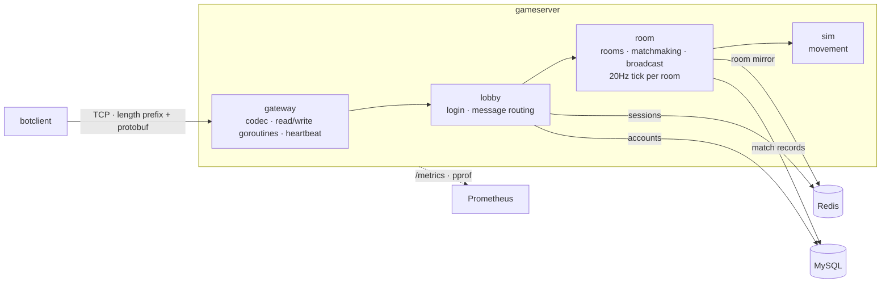

# game-server

[中文](README.md) · English

A server for small real-time multiplayer games (2–8 players per room), written in Go. Long-lived TCP connections with Protobuf; login verification with sessions in Redis; rooms, quick match and in-room broadcast; server-authoritative state sync at 20Hz per room; accounts and match records in MySQL; Prometheus metrics + pprof; a purpose-built load-test client that reports P99 at 500 concurrent connections.

> The detailed design docs under `docs/` (ARCHITECTURE, DECISIONS, BENCHMARK) are written in Chinese. This page covers the numbers, the architecture and how to run it.

## Benchmark numbers

500 connections in 63 rooms. Each client sends 20 movement inputs + 5 Pings per second, so the server handles 12,500 inbound and 12,500 outbound messages per second. 5 s warm-up, 30 s measurement, 3 runs of the same configuration. The bots and the server run on the same machine; results are split by network path:

| | p50 | p99 | max |
|---|---|---|---|
| Ping RTT, in-container loopback | 121–140 µs | **0.44–0.52 ms** | 1.1–3.8 ms |
| Ping RTT, host 127.0.0.1 (detours through Windows, see below) | 353–375 µs | **1.08–1.40 ms** | 3.0–5.5 ms |
| Snapshot interval (the 20Hz beat as seen by the client) | 50.00 ms | **51.1–51.6 ms** | 52.1–55.2 ms |
| One server tick (advance + encode + deliver to 8 players) | 5–10 µs | 10–50 µs | |

Snapshot delivery 99.989%–100.002%, 0 failures, 0 disconnects, server at 0.4–0.6 cores.

The 3× gap between the two RTT rows is the network path, not the program. This WSL2 machine runs in mirrored networking mode, where TCP to 127.0.0.1 on the host goes out to Windows and back; a container has its own network namespace and uses the real kernel loopback. The investigation is in BENCHMARK B6.2.

Scaling up the connection count (in-container, 1 run per step): at 6,000 connections every target is still met, with snapshot interval p99 51.9 ms and RTT p99 1.6 ms. The knee is between 8,000 and 10,000, and tail latency degrades first; by then the server (6 cores) and the bots (6.6 cores) are competing for CPU on the same 20-thread machine.

Environment: i5-14600KF, WSL2. Methodology, the flame graph, the knee, and why the first version of the load-test client measured an 11 ms P99 are in [docs/BENCHMARK.md](docs/BENCHMARK.md).

## Architecture



- **Gateway**: frames are split on a 4-byte length prefix; each connection gets one read and one write goroutine; when a connection's bounded send queue fills up, that slow client is disconnected; heartbeat + idle timeout drop dead connections.
- **Login**: stateless HMAC token, checked against the MySQL account table, session written to Redis; logging in again with the same account kicks the old connection.
- **Rooms**: one global lock for membership, one lock per room for game state; events and snapshots are encoded once and every recipient shares the same bytes.
- **Sync**: server-authoritative state sync. Clients only send "which direction to move"; every 50 ms the server advances the world with a fixed step and broadcasts a full snapshot (149 bytes per frame for 8 players).

Layers, protocol, concurrency model and shutdown order are in [docs/ARCHITECTURE.md](docs/ARCHITECTURE.md). Every design decision, with why this, why not the alternatives, and when it would change, is in [docs/DECISIONS.md](docs/DECISIONS.md): for example why state sync rather than lockstep (D17), why the tick does not take the global lock (D12b), and why a Ticker rather than Sleep (D20).

## How to run

### Locally (needs Go 1.27+ and a Redis)

```bash
git clone https://github.com/Anthonyz5527083/game-server.git
cd game-server

make test     # all tests (with -race). Redis is the in-process miniredis, no Docker needed
make run      # server: TCP :7777, admin (/metrics, pprof) on 127.0.0.1:9100, Redis at 127.0.0.1:6379
```

Start Redis with `make redis` (Docker) or use a locally installed one. Without `GS_MYSQL_DSN` the server does not connect to MySQL: no account check and no match records, everything else works.

Watch two clients see each other (one terminal each):

```bash
make watch                              # player 1 quick-matches into a room, walks in circles, prints snapshots

export GS_TOKEN_SECRET=local-dev-only-not-a-secret   # the same dev secret as in the Makefile and compose; make sets it, running bin/ directly needs it
./bin/botclient -player 2 -watch        # player 2 joins the same room and watches player 1's coordinates change
```

```
logged in as player 2
in room 1, members [1 2]
tick=8      1:(61.0,50.1)#1  2:(57.1,57.1)#0
tick=12     1:(62.0,50.3)#2  2:(57.1,57.1)#0
tick=16     1:(62.9,50.6)#3  2:(57.1,57.1)#0
```

The number after `#` is the last input sequence number the server has applied (`last_input_seq`, kept for client-side prediction, D19).

Load test (500 connections, 5 s warm-up + 30 s measurement):

```bash
make bench    # bots and server both on the host; with WSL2 mirrored networking this measures the detour in the second row above
curl -s 127.0.0.1:9100/metrics | grep ^gameserver_   # in another terminal: online players, rooms and message counters during the run
```

### Docker Compose

```bash
make up             # docker compose -f deploy/docker-compose.yml up -d --build: gameserver + Redis + MySQL
make bot            # connect with the host botclient (make up does not build the host bin/, make bot does)
make bench-compose  # 500-connection load test with the bots inside the gameserver container (in-container loopback; the first row above was measured this way)
make down           # stop; make down-v also deletes the MySQL volume
```

On first start MySQL runs [deploy/mysql/init.sql](deploy/mysql/init.sql): it creates the account and match-record tables and seeds accounts 1–10000. All ports bind to 127.0.0.1 only.

The runtime image is 9.8 MB compressed (distroless/static + three static binaries). From `make up` to the first bot logging in takes about 2 s when the data volume already exists, and 8–9 s the first time (MySQL has to initialise).

When load-testing the containers, don't connect from the host through the mapped port: that path goes through docker-proxy, p99 rises to 1.6–2.1 ms, and docker-proxy itself uses more than one core (D27).

`docker compose -f deploy/docker-compose.yml --profile monitoring up -d` also starts a Prometheus (127.0.0.1:9090) that scrapes gameserver every 5 seconds.

### Configuration

| | Default | Notes |
|---|---|---|
| `GS_TOKEN_SECRET` | none (the Makefile and compose carry a dev value) | token signing key, at least 16 bytes. Environment variable only |
| `GS_MYSQL_DSN` | unset | e.g. `game:pass@tcp(127.0.0.1:3306)/game`. Unset means no MySQL |
| `-addr` / `-admin` / `-redis` | `:7777` / `127.0.0.1:9100` / `127.0.0.1:6379` | `-admin ''` disables the admin port |
| `-idle-timeout` / `-login-timeout` / `-session-ttl` | 30s / 10s / 1m | |
| `-log-json` / `-log-level` | text / info | |

`./bin/tokengen -player 42` issues a token signed with the same key. botclient signs its own tokens when it has the key, so a load test doesn't need 500 runs of tokengen first.

## Protocol at a glance

```
+----------------------+-----------------------------------+
| length: uint32 BE    | body: protobuf-encoded Envelope   |
+----------------------+-----------------------------------+
Envelope { seq, oneof payload }   field numbers: 10–19 gateway · 20–29 login · 30–39 room · 40–49 sync
```

Maximum frame size 64 KiB. Full definition in [proto/game.proto](proto/game.proto).

## Layout

```
proto/              protocol definition (generated Go code is committed, in internal/pb)
cmd/gameserver/     server entry point
cmd/botclient/      smoke / watch / load-test client
cmd/tokengen/       dev token issuer
internal/gateway/   TCP connections, frame codec, heartbeat, send queue
internal/auth/      HMAC token
internal/lobby/     login state machine, message routing
internal/room/      rooms, quick match, broadcast, tick loop, Redis mirror, match-record queue
internal/sim/       movement (pure functions)
internal/storage/   Redis: sessions, room mirror; MySQL: accounts, match records
internal/metrics/   Prometheus metrics, admin handler
deploy/             docker compose, MySQL schema, Prometheus config
docs/               ARCHITECTURE · DECISIONS · BENCHMARK (in Chinese)
```
