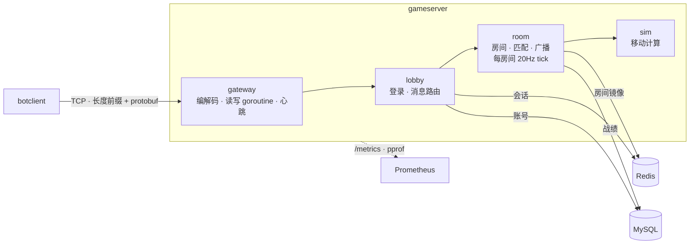

# game-server

一个 2–8 人实时同步小游戏的服务端,用 Go 写。TCP 长连接 + Protobuf;登录校验、会话落 Redis;房间、快速匹配和房间内广播;每个房间 20Hz 的服务端权威状态同步;账号和战绩存 MySQL;Prometheus 指标 + pprof;自写的压测客户端在 500 并发下给出 P99。

## 压测数字

500 条连接、63 个房间,每个客户端每秒 20 个移动输入 + 5 个 Ping,服务端每秒入站 12,500 条、出站 12,500 条消息。预热 5 秒、测量 30 秒,同一配置跑 3 次:

| | p50 | p99 | max |
|---|---|---|---|
| Ping RTT | 353–375 µs | **1.08–1.40 ms** | 3.0–5.5 ms |
| 快照间隔(客户端看到的 20Hz 节拍) | 50.00 ms | **51.40–51.64 ms** | 52.9–54.1 ms |
| 服务端一次 tick(推进 + 编码 + 投递 8 人) | 5–10 µs | 25–50 µs | |

快照到达率 100.000%(30 万个里多 2 个到少 1 个),0 失败、0 断线;服务端约 0.5 个核、RSS 45–55 MB。连接数往上加,拐点在 2000–3000 之间,先撑不住的是每条消息一次系统调用和 goroutine 唤醒带来的尾延迟,不是 CPU。

环境是 i5-14600KF、WSL2、bot 和服务端同机走 loopback。方法、火焰图、拐点、以及第一版压测客户端为什么量出了 11 ms 的 P99,见 [docs/BENCHMARK.md](docs/BENCHMARK.md)。

## 架构



- **网关**:4 字节长度前缀切帧,每条连接一读一写两个 goroutine,有界发送队列满了就断开慢客户端,心跳 + idle 超时踢人。
- **登录**:无状态 HMAC token,查 MySQL 账号表,会话写 Redis;同一账号再次登录踢掉旧连接。
- **房间**:一把全局锁管成员关系,每个房间一把锁管游戏状态;事件和快照都只编码一次、所有人共享同一份字节。
- **同步**:服务端权威的状态同步。客户端只发「往哪个方向走」,服务端每 50 ms 用固定步长推进、广播全量快照(8 人一帧 149 字节)。

分层、协议、并发模型和关停顺序见 [docs/ARCHITECTURE.md](docs/ARCHITECTURE.md)。每个设计决定「为什么是这个 / 为什么不是别的 / 什么时候会换」见 [docs/DECISIONS.md](docs/DECISIONS.md),比如为什么选状态同步不选帧同步(D17)、tick 为什么不拿全局锁(D12b)、为什么用 Ticker 不用 Sleep(D20)。

## 怎么跑

### 本地跑(需要 Go 1.27+ 和一个 Redis)

```bash
git clone https://github.com/Anthonyz5527083/game-server.git
cd game-server

make test     # 全部测试(带 -race)。Redis 用进程内的 miniredis,不需要 Docker
make run      # 服务端:TCP :7777,admin(/metrics、pprof)127.0.0.1:9100,连 127.0.0.1:6379 的 Redis
```

Redis 可以用 `make redis`(Docker)起,也可以用本机装的。不设 `GS_MYSQL_DSN` 时不连 MySQL:不查账号表、不记战绩,其它功能都在。

看两个客户端互相看见(各开一个终端):

```bash
make watch                              # 玩家 1 快速匹配进房间,绕圈走,打印快照
./bin/botclient -player 2 -watch        # 玩家 2 进同一个房间,看着玩家 1 的坐标变
```

```
logged in as player 2
in room 1, members [1 2]
tick=8      1:(61.0,50.1)#1  2:(57.1,57.1)#0
tick=12     1:(62.0,50.3)#2  2:(57.1,57.1)#0
tick=16     1:(62.9,50.6)#3  2:(57.1,57.1)#0
```

`#` 后面是服务端已经应用到的输入序号(`last_input_seq`,留给客户端预测用,D19)。

压测(500 连接,预热 5 秒 + 测量 30 秒):

```bash
make bench
curl -s 127.0.0.1:9100/metrics | grep ^gameserver_   # 另一个终端,压测中看在线人数、房间数、消息计数
```

### Docker Compose 一键起

```bash
make up       # docker compose -f deploy/docker-compose.yml up -d --build:gameserver + Redis + MySQL
make bot      # 用宿主机上的 botclient 连进去(make up 不会编译宿主机的 bin/,make bot 会)
make down     # 停掉;make down-v 连 MySQL 数据卷一起删
```

MySQL 第一次启动时自动执行 [deploy/mysql/init.sql](deploy/mysql/init.sql):建账号表和战绩表,种子账号 1–10000。所有端口只绑 127.0.0.1。

> Compose 这一套还没有在 Docker 上实际跑过(开发机上还没装 Docker)。镜像里用的构建命令、建表脚本和 MySQL 8.4 已经单独验证过,详见 BENCHMARK「还没测的」。

### 配置

| | 默认 | 说明 |
|---|---|---|
| `GS_TOKEN_SECRET` | 无(Makefile 和 compose 里有开发用的值) | token 签名密钥,至少 16 字节。只走环境变量 |
| `GS_MYSQL_DSN` | 不设 | 例如 `game:pass@tcp(127.0.0.1:3306)/game`。不设就不连 MySQL |
| `-addr` / `-admin` / `-redis` | `:7777` / `127.0.0.1:9100` / `127.0.0.1:6379` | `-admin ''` 关掉 admin 端口 |
| `-idle-timeout` / `-login-timeout` / `-session-ttl` | 30s / 10s / 1m | |
| `-log-json` / `-log-level` | text / info | |

`./bin/tokengen -player 42` 用同一个密钥签发 token。botclient 手里有密钥时会自己签,压测不用先跑 500 次 tokengen。

## 协议速览

```
+----------------------+-----------------------------------+
| length: uint32 大端  | body: Envelope 的 protobuf 编码    |
+----------------------+-----------------------------------+
Envelope { seq, oneof payload }   字段号:10–19 网关 · 20–29 登录 · 30–39 房间 · 40–49 同步
```

单帧上限 64 KiB。完整定义见 [proto/game.proto](proto/game.proto)。

## 目录

```
proto/              协议定义(生成的 Go 代码入库,在 internal/pb)
cmd/gameserver/     服务端入口
cmd/botclient/      冒烟 / 观察 / 压测客户端
cmd/tokengen/       开发用的 token 签发工具
internal/gateway/   TCP 连接、帧编解码、心跳、发送队列
internal/auth/      HMAC token
internal/lobby/     登录状态机、消息路由
internal/room/      房间、快速匹配、广播、tick 循环、Redis 镜像、战绩队列
internal/sim/       移动计算(纯函数)
internal/storage/   Redis:会话、房间镜像;MySQL:账号、战绩
internal/metrics/   Prometheus 指标、admin handler
deploy/             docker compose、MySQL 建表脚本、Prometheus 配置
docs/               ARCHITECTURE · DECISIONS · BENCHMARK
```
