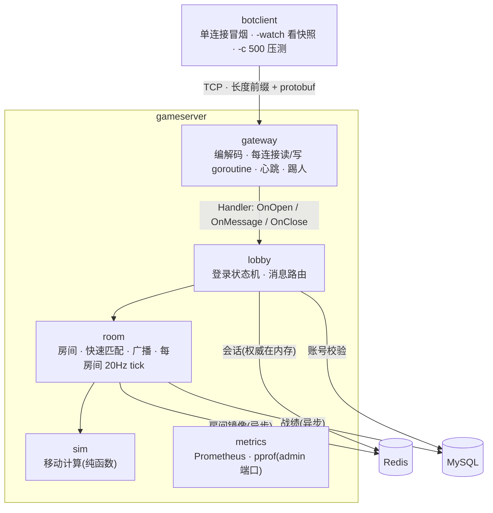
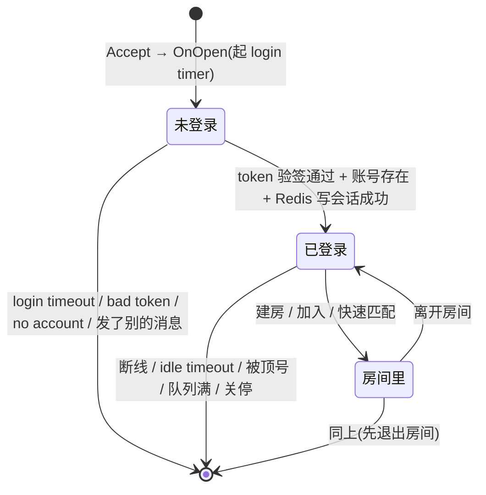

# ARCHITECTURE

## 分层



| 包 | 职责 | 依赖 |
|---|---|---|
| `internal/gateway` | TCP 连接、帧编解码、心跳应答、idle 踢人、发送队列 | `pb` `metrics` |
| `internal/auth` | 签发 / 校验 HMAC token | 标准库 |
| `internal/lobby` | 登录状态机(验签 → 查账号 → 写会话);登录后的消息分发给房间 | `gateway` `auth` `room` `sim` `storage` |
| `internal/room` | 房间成员关系、快速匹配、事件广播、每房间 tick 循环、Redis 镜像、战绩队列 | `gateway`(只用 `Marshal`)`sim` `metrics` `pb` |
| `internal/sim` | 一个房间里的玩家状态和移动计算,不碰锁、网络和时钟 | 标准库 |
| `internal/storage` | Redis:会话、房间镜像;MySQL:账号、战绩 | `room`(只用 `Info`、`MatchRecord`)、go-redis、go-sql-driver |
| `internal/metrics` | 指标定义、`/metrics` 和 pprof 的 handler | `pb`、client_golang |
| `cmd/gameserver` | 读配置、组装、信号处理、admin HTTP | 以上全部 |
| `cmd/botclient` / `cmd/tokengen` | 测试工具 | `gateway` `auth` `pb` |

网关不认识业务:除了 Ping,所有消息都通过 `Handler` 交给大厅。`sim` 不知道网络和并发的存在,所以能直接做表驱动测试(D20)。

## 协议

```
+----------------------+-----------------------------------+
| length: uint32 大端  | body: Envelope 的 protobuf 编码    |
+----------------------+-----------------------------------+
```

- `length` 只计 body;body 为 0 字节或超过 64 KiB 都是协议错误,直接断开(D2)。
- body 永远是 `Envelope{seq, oneof payload}`(D1)。字段号按模块分段:10–19 网关,20–29 登录,30–39 房间,40–49 同步。
- `seq`:请求方自增,应答原样带回;服务端主动推送(广播、快照、踢人)时 seq 为 0。

| 方向 | 消息 | 说明 |
|---|---|---|
| C → S | `Ping` | 心跳,网关直接回 `Pong`,登录前也能发 |
| S → C | `Kick` | 断开前的最后一帧,带原因 |
| C → S | `LoginReq{token}` | 连接上第一条业务消息 |
| S → C | `LoginResp{code, player_id}` | |
| C → S | `CreateRoomReq` / `JoinRoomReq{room_id}` / `QuickMatchReq` / `LeaveRoomReq` | 登录后才能发 |
| S → C | `RoomResp{code, room}` | 上面四种请求共用的应答 |
| S → C | `RoomEvent{kind, player_id, room}` | 推给房间里的其他人(不含触发者) |
| C → S | `MoveInput{seq, dir_x, dir_y}` | 「现在往哪个方向走」,没有应答;不在房间里就丢掉(D16) |
| S → C | `Snapshot{room_id, tick, players[{player_id, x, y, last_input_seq}]}` | 每个 tick 发给房间里所有人的全量状态(D18) |

结果码 `Code` 所有应答共用,0 是成功。完整定义见 `proto/game.proto`。

## 连接生命周期



关闭原因(日志里的 `reason`,也是 `OnClose` 收到的参数):

| 原因 | 谁触发 | 客户端会先收到 |
|---|---|---|
| `client closed` | 对端 EOF / RST | — |
| `idle timeout` | IdleTimeout 内没收到任何帧 | — |
| `protocol error` | 帧超限、截断、解码失败、没登录就发业务消息 | — |
| `send queue full` | 慢客户端,发送队列满 | — |
| `server shutdown` | 服务端关停 | — |
| `login timeout` | 连上之后 LoginTimeout 内没登录 | `Kick` |
| `bad token` | token 签名错 / 过期 / 格式错 | `LoginResp` 带错误码 |
| `no account` | token 合法,账号表里没有这个玩家 | `LoginResp{NO_ACCOUNT}` |
| `replaced` | 同一账号在别的连接上登录 | `Kick` |

## 并发模型

谁拥有哪些 goroutine(500 连接时一共 1,071 个,逐项见 BENCHMARK「资源与归零」):

| goroutine | 数量 | 做什么 |
|---|---|---|
| 连接读 | 每连接 1 | 解帧、分发;`Handler` 的三个回调都在它上面按顺序执行 |
| 连接写 | 每连接 1 | 独占 `Write`,从有界队列取帧 |
| 房间 tick | 每房间 1 | 20Hz:推进 world、编码快照、投递给所有成员 |
| 网关 Accept、会话续期、房间镜像、战绩写入、admin HTTP、信号处理 | 各 1 | 后台任务 |

- **发送不阻塞**:任何 goroutine 调 `Send` 都只是往有界队列投递,队列满就断开对方(D4)。所以广播方(房间事件、tick)可以持锁发送。
- **同一条连接的回调不并发**:连接可能被别的 goroutine 关掉(广播时发现队列满),但 `OnClose` 不在那个 goroutine 上跑,而是读 goroutine 被唤醒后再跑。大厅处理同一条连接的消息和断线时不用担心交错。
- **锁**:大厅一把;房间管理一把全局锁管成员关系,每个房间一把锁管游戏状态(D12b);网关的连接表一把。顺序固定为 大厅 → 房间管理 → 房间 → 网关,没有反向调用,所以不会死锁。tick 只拿自己房间的锁,不碰全局锁。
- **不在锁里做网络 I/O**:登录时先在锁外查 MySQL、写 Redis,成功了再拿锁改内存;续期、房间镜像在锁里拍快照、锁外写;战绩在锁里投递进队列、锁外写库(D7、D13、D28)。

## 登录与会话

- token 是无状态的 HMAC 签名,验签不查存储(D6)。验签通过之后,如果配了 MySQL,再按主键查账号存不存在(D28)。
- 「玩家 → 连接」的权威数据在大厅的内存表里;Redis 里的 `gs:session:{pid}` 是镜像,hash 存 `owner` 和 `login_at`,TTL 60 秒(D7、D9)。
- 续期:一个 goroutine 每 20 秒用一次 MULTI/EXEC 覆盖写全部在线玩家。覆盖写所以 Redis 重启后能补回来;写完再检查一遍,期间下线的玩家按 owner 删掉,防止续期把刚删的会话写回去。
- 删除会话用 Lua 脚本「owner 相同才删」,同一账号换了连接之后,旧连接断开删不掉新会话(D8)。

## 房间与同步

- `room.Manager` 的全局锁管全部房间和「玩家 → 房间」索引(D12)。快速匹配进房间号最小的未满房间,没有就新建。
- 事件(JOINED / LEFT)编码一次,共享同一个 `[]byte`,在锁里发给除触发者以外的成员,保证顺序(D14)。
- 每个房间建立时起一个 tick goroutine,房间解散时 `close(stop)` 让它退出(D12b)。每个 tick:应用每个玩家最新的一条输入 → 按固定 dt = 50 ms 推进位置 → 编码一次快照 → 投递给所有成员(D16、D20)。
- 输入路径:读 goroutine → 大厅锁里 `Manager.Input` → 全局锁里查到房间就放锁 → 房间锁里记下这条输入。位置只在 tick 里变。
- 进房间时成员列表、world 和 JOINED 事件在同一段房间锁里完成,所以房间里的人一定先收到「X 进来了」,再收到带着 X 的快照。
- Redis 镜像:`gs:rooms`(房间号 set)和 `gs:room:{id}`(成员 set)。变化记进 dirty 集合,镜像 goroutine 异步写;启动、每 30 秒、停止时各全量覆盖一次(D13)。
- 房间解散时生成一条战绩,投递进有界队列,由单独的 goroutine 写 MySQL(D28)。

## 可观测性

admin 端口(默认 `127.0.0.1:9100`,只给本机 / 内网)上挂两样东西(D21、D22):

| 路径 | 内容 |
|---|---|
| `/metrics` | `gameserver_connections` / `players_online` / `rooms`(gauge,抓取时现算);`gameserver_messages_total{dir, type}`(counter);`gameserver_tick_duration_seconds`、`gameserver_tick_lateness_seconds`(histogram,微秒级的桶);以及 Go runtime 和进程的默认指标 |
| `/debug/pprof/` | CPU、堆、goroutine、mutex 等 profile |

日志用标准库 `log/slog`,`-log-json` 输出 JSON。每条连接的日志带 `conn` 和 `remote` 字段。

## 关停顺序

1. SIGINT / SIGTERM 取消 ctx。
2. 网关关 listener,关所有连接(原因 `server shutdown`)。
3. 每条连接的 `OnClose`:离开房间(最后一个人离开时房间解散、tick 停止、战绩入队)、删 Redis 会话。网关等这些全部跑完才返回(D5b)。
4. 后台 goroutine 这时才停:房间镜像最后全量同步一次(Redis 里不留房间);战绩队列里剩下的写完(最多 5 秒)。
5. admin HTTP 关闭,进程退出,退出码 0。

## 部署

```
deploy/docker-compose.yml   gameserver + redis:7.4 + mysql:8.4(+ 可选 prometheus)
deploy/mysql/init.sql       建表 + 种子账号 1–10000,MySQL 数据卷为空时自动执行
Dockerfile                  golang:1.27-alpine 构建 → distroless/static:nonroot 运行
```

- 配置全部走 flag 和环境变量。密钥(`GS_TOKEN_SECRET`)和带密码的 DSN(`GS_MYSQL_DSN`)只走环境变量,不出现在 `ps` 里。compose 里的默认值是开发用的,仓库里没有 `.env`。
- gameserver 等 Redis 和 MySQL 的 healthcheck 通过再启动;运行中依赖重启由应用自己扛(D26)。
- 所有映射端口只绑 127.0.0.1(D27)。
