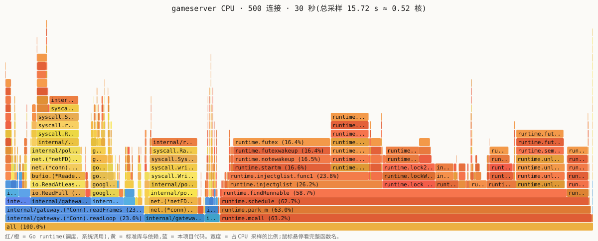

# BENCHMARK

数字一律实测。每组数字都写明环境、命令和跑了几次;没复现过的不写。

## 结论先看

500 条连接、63 个房间、每秒入站 12,500 条 / 出站 12,500 条消息,同一配置跑 3 次:

| 指标 | 3 次结果 | 门槛 |
|---|---|---|
| Ping RTT p99 | 1.08 / 1.32 / 1.40 ms | ≤ 12 ms |
| 快照间隔 p99(客户端看到的 20Hz 节拍) | 51.40 / 51.59 / 51.64 ms | ≤ 55 ms |
| 快照到达率 | 300,002 / 300,000 / 299,999 ÷ 300,000 | ≥ 99.9% |
| 服务端 tick 耗时 p99 | 25–50 µs 桶(插值约 49 µs) | < 1 ms |
| 失败 / 中途断线 | 0 / 0 | 0 |
| 服务端 CPU / RSS | 约 0.5 核 / 45–55 MB | 只记录 |

- 连接数往上加,拐点在 2000–3000 之间:2000 连接时快照间隔 p99 53 ms,3000 连接时 146 ms。先崩的不是 CPU(服务端只用了 2.9 核),是「每条消息一次系统调用 + 一次 goroutine 唤醒」的调度开销和尾延迟(见[拐点](#拐点b57))。
- 第一版压测客户端的 Ping p99 是 11 ms,原因在客户端:500 个 bot 的发送相位对齐,每 50 ms 一波突发。加随机相位之后是 1.1–1.4 ms(见[第一版](#第一版相位对齐的压测客户端))。

## 环境

| 项 | 值 |
|---|---|
| CPU | Intel Core i5-14600KF,20 个逻辑核(6P + 8E) |
| 内存 | 15 GiB |
| 系统 | WSL2,内核 6.18.40.1-microsoft-standard-WSL2 |
| Go | go1.27.1 linux/amd64,`GOMAXPROCS` 默认(20) |
| `ulimit -n` | 1048576 |
| 本地端口范围 | `ip_local_port_range` 44620–48715(只有 4096 个,限制了单个 bot 进程的连接数,见拐点) |
| Redis | 7.4.2,本机源码编译,直接跑在宿主机上(这台机器还没装 Docker) |
| MySQL | 8.4.9 官方 minimal 包,只在 MySQL 相关的验证里开 |
| 测量日期 | 微基准、冒烟 2026-10-06 和 10-11;压测 2026-10-11 |

bot 和服务端是同一台机器上的两个进程,走 loopback。WSL2 上的数字只对这台机器有效,换机器先重跑。

---

## 压测(B5)

### 方法

负载模型:

| | 值 | 说明 |
|---|---|---|
| 连接 | 500 | 全部登录后快速匹配,进 63 个房间(62 × 8 + 1 × 4) |
| 每个 bot | 20 MoveInput + 5 Ping / s | Ping 按 ticker 发,不等上一个 Pong(open-loop,避免 coordinated omission);开始前等一个 0–200 ms 的随机相位 |
| 入站 | 12,500 msg/s | 500 × 25 |
| 出站 | 12,500 msg/s | 500 × (20 快照 + 5 Pong) |
| 时长 | 预热 5 s + 测量 30 s | 只统计测量窗口内到达的样本 |
| 分位数 | 最近秩 | `sorted[ceil(p·n) − 1]`,不插值(D23) |

```bash
make build
./bin/gameserver -addr 127.0.0.1:17777 -admin 127.0.0.1:19100 -log-level warn &
./bin/botclient -addr 127.0.0.1:17777 -c 500 -d 30s -warmup 5s
```

压测开始 10 s 和 20 s 时各抓一次 `/metrics`,两次相减得到这 10 s 的速率和直方图;bot 退出 2 s 后再抓一次看是否归零。服务端日志级别 warn(每条连接的上下线日志不进热路径)。

### 结果:客户端视角(B5.1–B5.3)

| 次 | Ping RTT p50 / p99 / max | 快照间隔 p50 / p99 / max | 快照 实收 / 期望 | 失败 / 断线 |
|---|---|---|---|---|
| 1 | 375 µs / 1.315 ms / 4.12 ms | 50.00 / 51.59 / 53.89 ms | 300,002 / 300,000 | 0 / 0 |
| 2 | 353 µs / 1.402 ms / 5.51 ms | 50.00 / 51.64 / 54.11 ms | 300,000 / 300,000 | 0 / 0 |
| 3 | 362 µs / 1.075 ms / 2.97 ms | 50.00 / 51.40 / 52.89 ms | 299,999 / 300,000 | 0 / 0 |
| **中位数** | **362 µs / 1.315 ms / 4.12 ms** | **50.00 / 51.59 / 53.89 ms** | **100.000%** | |

每次 75,000 个 RTT 样本、约 30 万个快照间隔样本。实收比期望多一两个,是测量窗口边界的效果:30 s 的窗口里一个 50 ms 周期的事件出现 600 或 601 次。

### 结果:服务端视角(B5.4、B5.5,T5.3–T5.5)

压测第 10–20 s 的 `/metrics` 差值:

| 次 | 在线 / 房间 | 入站 msg/s | 出站 msg/s | tick 次数/s | tick 耗时 p50 / p99 | tick 准点 p50 / p99 |
|---|---|---|---|---|---|---|
| 1 | 500 / 63 | 12,507 | 12,503 | 1,260.4 | 5–10 µs 桶(≈8.5) / 25–50 µs 桶(≈49.6) | 100–250 µs 桶 / 1–2 ms 桶 |
| 2 | 500 / 63 | 12,505 | 12,501 | 1,260.0 | 5–10 µs 桶(≈8.3) / 25–50 µs 桶(≈48.9) | 100–250 µs 桶 / 1–2 ms 桶 |
| 3 | 500 / 63 | 12,505 | 12,504 | 1,260.4 | 5–10 µs 桶(≈8.6) / 25–50 µs 桶(≈49.8) | 100–250 µs 桶 / 1–2 ms 桶 |

- T5.3:压测中 `gameserver_players_online` = 500,`gameserver_rooms` = 63。
- T5.4:入站 counter 增速 12,505–12,507/s,期望 12,500(+0.06%)。其中 MoveInput 10,004/s、Ping 2,501/s;出站快照 10,000–10,003/s、Pong 2,501/s。
- T5.5:tick 直方图 `_count` 增速 1,260.0–1,260.4/s,期望 63 × 20 = 1,260。
- 括号里是桶内线性插值的估计,精度只到桶(D22)。tick 耗时比微基准 B4.3(0.87 µs)大一个数量级。微基准里投递是空操作;真实负载下要往 8 个 channel 发送、唤醒 8 个写 goroutine,还可能等读 goroutine 放房间锁,多出来的时间应该在这里(没有单独拆)。即使如此,p99 也只用了 50 ms 预算的 0.1%。
- tick 准点和空载对比(B4.1:p50 0.56–0.60 ms,p99 1.1–1.6 ms):满载时 p50 反而更低(100–250 µs)。我的解释是空载时线程都睡着了,tick 到点要先叫醒一个线程;满载时总有线程醒着,timer 到点能直接被调度。p99 两者都在 1–2 ms。

### 资源与归零(B5.6、T5.6)

| | 压测前 | 压测中 | bot 全部断开 2–3 s 后 |
|---|---|---|---|
| 在线 / 房间 | 0 / 0 | 500 / 63 | 0 / 0 |
| goroutine(pprof) | 8 | 1,071 | 8 |
| RSS(`/proc/<pid>/status` VmRSS) | | 44.6 / 48.5 / 54.4 MiB(3 次) | |

goroutine 逐项算:500 条连接 × 2(读、写)+ 63 个房间 tick + 8 个常驻(main 里的网关 Serve、信号处理 2 个、admin HTTP Serve、会话续期、房间镜像,以及抓 pprof 这一次请求自己的 2 个)= 1,071。压测前后都是 8,没有泄漏。

### CPU 火焰图(T5.7)

压测中用 admin 端口抓 30 s CPU profile:

```bash
curl -o cpu.pb.gz 'http://127.0.0.1:19100/debug/pprof/profile?seconds=30'
go tool pprof -http=:8080 bin/gameserver cpu.pb.gz   # 浏览器里 View → Flame Graph
```

原始 profile 在 [`profiles/cpu-500c-30s.pb.gz`](profiles/cpu-500c-30s.pb.gz),下图是它的静态渲染(`go tool pprof -traces` 折叠成栈后画成 SVG):



30 s 里采到 15.72 s,平均 0.52 个核。最宽的三个栈:

1. **调度器:`runtime.mcall → schedule → findRunnable`,63%**。其中 `futexwakeup` / `notewakeup` / `startm` 是在唤醒睡眠的 OS 线程,`injectglist` 是把 netpoller 就绪的 goroutine 放回运行队列。1,000 多个 goroutine 每个每秒被唤醒 20–25 次,每次都可能要叫醒一个线程,这就是「很多很轻的活」的代价。
2. **读循环:`gateway.(*Conn).readLoop`,23.6%**。read 系统调用约 7%,protobuf 解码约 5.5%,大厅处理 MoveInput 1.9%,`SetReadDeadline` 约 1%。
3. **写循环:`gateway.(*Conn).writeLoop`,10.3%**,几乎全是 write 系统调用(一帧一次 Write)。

业务代码(tick、大厅、编解码、metrics)加起来不到 15%:tick 2.2%,metrics 计数 2.2%(按类型计数用了 protobuf 反射 `WhichOneof`,和 tick 一样贵,是一个能省的点),编码 1.7%。CPU 主要花在系统调用和线程的睡眠 / 唤醒上,所以要扛更多连接,方向是减少系统调用和唤醒次数(写循环把积压的帧合并成一次 `writev`),而不是优化游戏逻辑。

### 第一版:相位对齐的压测客户端

第一版 botclient 在同一个循环里给 500 个 bot 建 ticker,所有 bot 的发送时刻是对齐的。完整跑一次(30 s,和上面同一个负载)的结果:

| | Ping RTT p50 / p99 / max | 快照间隔 p99 | 服务端 tick 准点 p50 |
|---|---|---|---|
| 相位对齐(第一版) | 4.05 / 10.99 / 12.72 ms | 51.39 ms | 250–500 µs 桶 |
| 随机相位(现在) | 0.35–0.38 / 1.08–1.40 / 3.0–5.5 ms | 51.40–51.64 ms | 100–250 µs 桶 |

当时服务端只用了 0.42 个核、bot 0.66 个核,却有 4 ms 的 RTT 中位数,说明时间不是花在计算上。按连接数扫一遍(每档测 8 s)就清楚了:

| 连接数 | 相位对齐 RTT p50 / p99 | 随机相位 RTT p50 / p99 |
|---|---|---|
| 1 | 338 µs / 600 µs | 324 µs / 622 µs |
| 50 | 922 µs / 1.78 ms | 255 µs / 547 µs |
| 200 | 2.13 ms / 4.77 ms | 262 µs / 738 µs |
| 500 | 4.55 ms / 12.73 ms | 370 µs / 1.26 ms |

相位对齐时 RTT 随连接数线性增长:每 50 ms 有 500 条消息在同一瞬间到达,服务端和 bot 都要先把这一波排队消化完,量到的主要是排队时间。真实玩家的发送时刻是随机的,压测客户端也应该是(D23)。在找到原因之前,还试过把两边的 `GOMAXPROCS` 在 2 / 4 / 20 之间组合(每种测 10 s):对齐时 RTT p50 在 2.6–5.6 ms 之间,没有一种回到 0.4 ms,说明不是「核太多、调度器空转」的问题。

### 拐点(B5.7)

连接数往上加,其它负载参数不变,每档预热 5 s、测量 15 s,各跑 1 次(探索性的,不是三次复现的结论):

| 连接数 | 房间 | Ping RTT p50 / p99 | 快照间隔 p99 / max | 到达率 | 服务端 CPU / RSS | bot CPU |
|---|---|---|---|---|---|---|
| 500 † | 63 | 0.36 ms / 1.3 ms | 51.6 / 53.9 ms | 100.000% | 0.5 核 / 45–55 MB | — |
| 1000 | 125 | 0.58 ms / 2.1 ms | 51.7 / 55.2 ms | 100.003% | 1.4 核 / 74 MB | 1.5 核 |
| 2000 | 250 | 0.75 ms / 7.5 ms | 53.1 / 66.1 ms | 100.003% | 2.7 核 / 116 MB | 2.9 核 |
| **3000** | 375 | 1.93 ms / **637 ms** | **145.7** / 1764 ms | 99.987% | 3.5 核 / 154 MB | 3.6 核 |
| 4000 | 480 | 4.2 ms / 1372 ms | 234.9 / 4439 ms | 100.8%* | 4.2 核 | 4.5 核 |

† 500 那一行来自上面的 3 次正式压测(测 30 s),其它档各跑 1 次。\* 4000 档有 163 条连接没连上(`connect: cannot assign requested address`),运行中 6 条读超时断开:这台机器的本地端口范围只有 4096 个,一个 bot 进程连同一个服务端地址最多 4000 条左右。到达率按实际连上的 3837 条算期望;超过 100% 是因为延迟已经大到秒级,预热阶段积压在缓冲区里的快照到了测量窗口里才被读到,也被算了进去。这一档的数字只说明「已经劣化」。8000 档只连上 4055 条,不列。

**拐点在 2000–3000 之间**:按「快照间隔 p99 > 60 ms 或到达率 < 99.9%」的标准,3000 是第一个不过的档。这时两个进程加起来用了约 7 个核,机器有 20 个逻辑核,CPU 没满。3000 档另跑一次、抓 15 s profile(服务端 2.9 核):系统调用 34%、`findRunnable` 40%、`futex` 24%,大厅和编解码加起来不到 10%;`/metrics` 里最近几次 GC 的 STW 停顿最长 12.6 ms。所以「QPS × 10 先崩哪」的回答是:每条消息一次 read / write 系统调用、一次 goroutine 唤醒,这条路径的调度延迟先撑不住,尾延迟先炸,吞吐和 CPU 都还有余量。bot 和服务端在同一台机器上抢调度,这一档里有多少延迟是 bot 自己的分不开,要拆开得把 bot 放到另一台机器上。

下一步按收益排:写循环合并积压的帧(`net.Buffers` / `writev`),减少写系统调用;快照和 Pong 合并发送;metrics 计数改成类型 switch,去掉反射;再往上(上万连接)才考虑 epoll 事件循环替代 goroutine-per-connection。

### -race 小规模压测(T5.1)

```bash
go build -race -o gameserver-race ./cmd/gameserver
./gameserver-race -addr 127.0.0.1:17777 -admin '' -log-level warn &
./bin/botclient -addr 127.0.0.1:17777 -c 50 -d 20s -warmup 2s
```

50 条连接 20 s:0 断线,快照 19,992 / 20,000,服务端 SIGTERM 后退出码 0,日志里 `DATA RACE` 0 处。

### 登录风暴(B2.2)

500 个 bot 同时连接并登录(就是压测的准备阶段),3 次:0 失败,登录耗时(发出 LoginReq 到收到 LoginResp)p50 14–65 ms、p99 30–82 ms。开了 MySQL 账号校验之后再跑 2 次:p50 60–69 ms、p99 93–138 ms,0 失败。耗时花在哪一步(token 校验、查账号、写 Redis、连接池排队)没有拆开量过。

---

## 微基准(`go test -bench`)

### 编解码(B1.1 / B1.2)

```
go test -run '^$' -bench . -benchmem -count 5 ./internal/gateway
```

| 基准 | 10-06 ns/op | 10-11 ns/op | B/op | allocs/op |
|---|---|---|---|---|
| `BenchmarkMarshalPing`:编码一帧 Ping(含长度头) | 133.3–136.8 | 147.8–150.2 | 16 | 1 |
| `BenchmarkReadEnvelopePing`:从 bufio.Reader 读一帧并解码 | 197.3–198.7 | 208.3–210.3 | 136 | 5 |

10-11 比 10-06 慢了约 10%,不是代码的原因:把 10-06 的提交(04d30ae)检出到另一个目录,同一时间跑同一个基准,也是 146.6–148.8 ns。两天之间变的是机器状态(压测之后的温度、频率),所以只在同一时间段里的数字之间做比较。编码只分配 1 次,是 `proto.Size` + `MarshalAppend` 到预留容量的 slice 的效果(D2)。

### 房间广播与 tick(B3.1 / B3.2 / B4.3)

```
go test -run '^$' -bench 'Broadcast|Tick8' -benchmem -count 5 ./internal/room
go test -run '^$' -bench QuickMatchLeave -benchmem -count 3 -cpu 1,4,20 ./internal/room
```

10-11 测量:

| 基准 | ns/op | B/op | allocs/op |
|---|---|---|---|
| `BenchmarkBroadcast/members=2`:一人加入 + 离开(两次广播) | 856.2–859.0 | 520 | 13 |
| `BenchmarkBroadcast/members=8` | 940.5–948.4 | 688 | 13 |
| `BenchmarkTick8`:8 人房一次 tick(推进 + 编码快照 + 投递 8 次) | 868.6–876.4 | 888 | 13 |
| `BenchmarkQuickMatchLeave`,`-cpu 1` | 1859–1875 | 547–552 | 13 |
| `BenchmarkQuickMatchLeave`,`-cpu 4` | 1092–1102 | 541 | 13 |
| `BenchmarkQuickMatchLeave`,`-cpu 20` | 1091–1093 | 644–646 | 13 |

- 2 人房和 8 人房的分配次数相同:广播只编码一次,所有人共享同一个 `[]byte`(D14)。字节数随成员数涨,是房间快照里的成员列表。和 10-06(677 / 852 ns)相比多出的部分,一半是上面说的机器状态,另一半是现在每次进出房间多拿一次房间锁、多记一次 metrics。
- tick 一次 0.87 µs,13 次分配,其中 8 个是快照里每个玩家的 `PlayerState`。8 人快照一帧 149 字节(`TestSnapshotSize8`,D18)。
- 一把锁下,4 核和 20 核的吞吐一样(每对操作约 1.1 µs,每秒约 90 万次进出),瓶颈就是那把锁;需求是每秒几十次,这把锁不是问题(D12)。

### Ticker 准点与 Sleep 漂移(B4.1 / B4.2)

一个 30 行的独立程序,不在仓库里,逻辑如下,跑 3 次:

```go
t := time.NewTicker(50 * time.Millisecond)      // B4.1:600 次,记录 |实际醒来 − (start + k·50ms)|
for k := 1; k <= 600; k++ { <-t.C; lat = append(lat, abs(time.Since(start.Add(k*50ms)))) }

for range 600 { busy(2 * time.Millisecond); time.Sleep(50 * time.Millisecond) }  // B4.2:总耗时 vs 理想 30 s
```

| 次 | Ticker 晚到 p50 / p99 / max | Sleep 循环多用的时间 | Sleep 循环实际频率 |
|---|---|---|---|
| 1 | 0.60 / 1.08 / 1.11 ms | +1.313 s(4.4%) | 19.16 Hz |
| 2 | 0.56 / 1.61 / 2.27 ms | +1.328 s(4.4%) | 19.15 Hz |
| 3 | 0.59 / 1.29 / 5.28 ms | +1.322 s(4.4%) | 19.16 Hz |

Ticker 每次都会晚一点(WSL2 上空载时约 0.6 ms,我认为主要是叫醒睡眠线程的时间),但不累积;Sleep 循环每一轮都多出干活的 2 ms 和唤醒延迟,600 轮累积多了 1.3 s。这是 tick 用 Ticker 的依据(D20)。

---

## 冒烟:loopback 串行 RTT(B1.3)

不是压测。单连接,发一个 Ping、等到 Pong 再发下一个,量的是「一次往返最少要多久」。2026-10-06:

```
./bin/gameserver -addr 127.0.0.1:17777 -log-level warn &
./bin/botclient -addr 127.0.0.1:17777 -player 1 -n 5000 -interval 1ms -q   # 跑 3 次
```

| 次 | min | p50 | p99 | max |
|---|---|---|---|---|
| 1 | 110.1 µs | 176.0 µs | 410.2 µs | 1.79 ms |
| 2 | 107.6 µs | 176.9 µs | 510.7 µs | 7.21 ms |
| 3 | 105.1 µs | 177.1 µs | 454.3 µs | 2.39 ms |

每次 5000 个样本,p99 只由最慢的 50 个决定,所以这组只算冒烟。

## Redis 基线(B2.1)

本机源码编译的 Redis 7.4.2,`redis-benchmark -q -n 100000 -t set,get`(默认 50 个并发客户端),3 次:

| 次 | SET req/s(p50) | GET req/s(p50) |
|---|---|---|
| 1 | 86,580(0.511 ms) | 103,413(0.407 ms) |
| 2 | 109,649(0.383 ms) | 107,066(0.391 ms) |
| 3 | 122,699(0.343 ms) | 102,775(0.415 ms) |

游戏服对 Redis 的压力远低于这个量级:登录时每人一次写,续期每 20 秒一次批量写,房间镜像只在进出房间时写。

## 还没测的

- **容器(B6.1–B6.3)**:镜像体积、容器里和裸跑的压测对比、`docker compose up` 到第一个 bot 登录的耗时。这台机器还没装 Docker,`Dockerfile` 和 `deploy/docker-compose.yml` 没有实际跑过。目前只验证了镜像里用的构建命令:`CGO_ENABLED=0 -trimpath -ldflags="-s -w"` 编出来的三个静态二进制一共 22 MB(gameserver 12.5 MB),去掉符号表之后 pprof 仍能解析函数名。
- **bot 和服务端分两台机器**:拐点那一档里 bot 自己的延迟占多少,要分开才知道。
